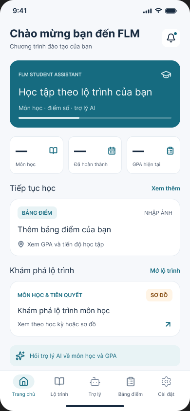
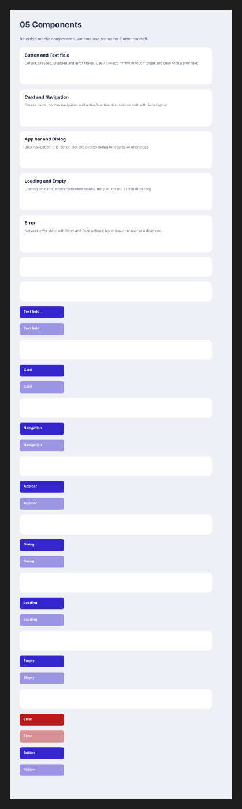
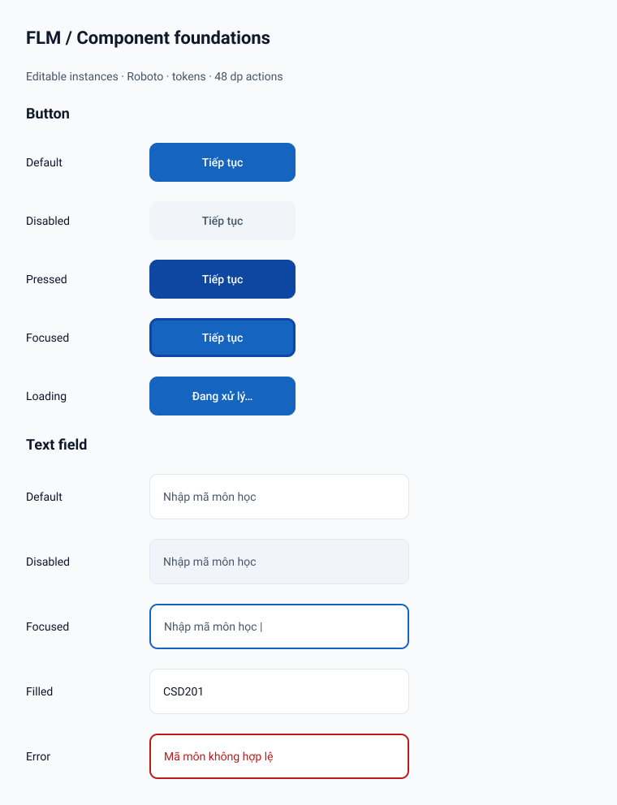
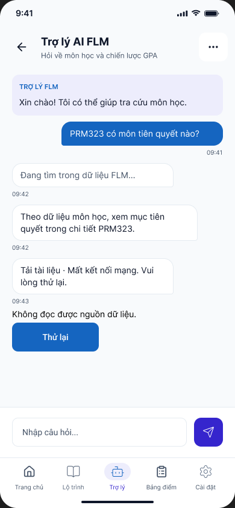

# Tiến độ chỉnh Figma Lab 2 ngày 21 tháng 10 năm 2026

File được người dùng cung cấp: [PRM323 Lab 2 FLM Student Assistant](https://www.figma.com/design/N3LyPn9HWDC0M34lVR5jCC/PRM323-Lab-2---FLM-Student-Assistant).

## Phạm vi lượt đầu

Kiểm tra cấu trúc, đối chiếu foundation với `flutter_app/lib/theme/app_theme.dart`, sửa Button và Text field trong file hiện có. Không tuyên bố toàn bộ Figma, Lab 2 hoặc app đã hoàn tất. Không thay đổi Flutter/backend trong lượt này.

## Quan sát trước khi sửa

- Có 3 page: `03 Final UI` (`0:1`), `01 User Flow` (`6:2`), `02 Wireframe` (`6:18`).
- `04 Design System`, `05 Components`, `06 Prototype` là section ở Final UI, không phải page.
- Final UI có 11 frame mobile 390×844, bao gồm màn bắt đầu và các state; không đồng nghĩa có đủ 8 màn khác nhau khớp S01–S08.
- Page User Flow có ba sơ đồ; Wireframe có các khung. Chưa nghiệm thu việc khớp ba flow đó với `ux/user-flow.md` hiện tại.
- Có 281 node có reaction và 3 starting point, nhưng hai starting point là các state của bảng điểm. Chưa chứng minh đủ ba flow đầu-cuối không dead-end.
- Chỉ có 11 local variable, không có local text style. Primary variable là tím, trong khi Flutter dùng xanh `#1565C0`; tài liệu accent vẫn `#F57C00` cũ.
- Button set có tên variant lỗi `=Default`, `=Disabled`; các component Text field/Card/Navigation/App bar/Dialog/Loading/Empty/Error đều là block 180×48 gần giống button. Chưa được xem là component đúng ngữ nghĩa.

Ảnh trước sửa:

## Đã sửa và kiểm tra

1. Giữ collection `FLM Lab 2 Tokens`, đặt mode `Light`, cập nhật semantic token theo source Flutter: primary, primary-dark/light, surface, card, text/muted, border, disabled, accent, error, success. Màu semantic tham chiếu primitive. Scope và code syntax được khai báo.
2. Thêm spacing/radius/elevation còn thiếu; giữ radius 8/16 cũ để tránh làm hỏng binding có sẵn. Tổng cộng **36 variable** gồm primitive và semantic; không phải 36 màu khác nhau.
3. Tạo **5 text style Roboto**: FLM/Title 22/28 Bold, Section 18/24 Bold, Body 14/20 Regular, Label 14/20 Medium, Caption 14/20 Regular.
4. Sửa **Button** set giữ ID `8:113`: State=Default, Disabled, Pressed, Focused, Loading; main component 180×48, Auto Layout, bind fill/radius/padding/gap. Giữ ID của hai variant cũ để bảo toàn instance hiện có.
5. Sửa **Text field** set `52:18`: State=Default, Disabled, Focused, Filled, Error; main component 320×56, Auto Layout, nền và border đúng ngữ nghĩa. Error có thông báo chữ và viền, không chỉ đổi màu. Giữ ID hai component cũ.
6. Tạo [review board `52:19`](https://www.figma.com/design/N3LyPn9HWDC0M34lVR5jCC/PRM323-Lab-2---FLM-Student-Assistant?node-id=52-19) có **10 instance thực**, một instance mỗi trạng thái. Main component nằm ở phần dưới section Components, ngoài review board.
7. Đã kiểm tra cấu trúc, variable bindings, type style IDs, kích thước và screenshot. Sửa opacity thừa của disabled variant sau vòng kiểm tra ảnh.
8. Đo contrast chữ trắng trên primary **5.75:1**, accent **5.50:1**. Hai phép đo màu này không thay thế kiểm tra toàn bộ màn hình.

Ảnh là export trực tiếp từ file Figma thật; không phải ảnh sinh bằng AI. Review board dùng layer text/component/instance chỉnh sửa được. Chat screenshot vẫn có các state trộn trên cùng một màn và phần màu/font cũ; đó là vấn đề cần tách khi làm prototype, chưa được đánh dấu đã xử lý.

## Quyết định

| ID | Phát hiện | Quyết định | Lý do và phạm vi |
|---|---|---|---|
| F01 | Token primary tím khác source Flutter | Modify | Dùng AppTheme làm nguồn cho foundation; không tự đổi toàn bộ màn teal hiện tại khi chưa đối chiếu từng màn |
| F02 | Accent trong docs không đạt màu đã sửa ở app | Modify | Đồng bộ `#B34700`, đo lại contrast với trắng |
| F03 | Button variants không có tên property hợp lệ | Modify | Đặt `State=...`, bổ sung focused/pressed/loading và giữ ID cũ |
| F04 | Text field giống button, không biểu diễn input error | Modify | Nền trắng, border/focus/error, filled/disabled rõ ràng và có nhãn lỗi |
| F05 | Dùng section như sáu page | Chưa giải quyết | API `createPage` báo Starter chỉ cho 3 page; thao tác tạo page thất bại trước khi lưu, không giả nhận đạt yêu cầu |

## Những phần còn mở và thứ tự tiếp theo

**Cập nhật sau khi người dùng bật bridge ngày 21/10:** Đã tạo 7 native component set (Card, Navigation, App bar, Dialog, Loading, Empty, Error), tổng 20 variants, tại frame nguồn `55:16`. [Review board `55:17`](https://www.figma.com/design/N3LyPn9HWDC0M34lVR5jCC/PRM323-Lab-2---FLM-Student-Assistant?node-id=55-17) có 20 instance thật. Cộng Button/Text field trước đó thành 9 family với 30 variants đã xử lý ở thư viện. Giữ nguyên 14 placeholder cũ để tránh ảnh hưởng màn đang dùng.

Đã sửa kích thước Auto Layout, icon và căn giữa action label; xem ảnh export thật [`seven-components-after.png`](evidence/2026-10-21/seven-components-after.png). Validator quét 702 node, không phát hiện lỗi trong hai frame; 44 target rõ ràng được kiểm minimum 48 dp. Scope nguồn mới có 243 color usage bind primitive variable và 67 typography usage bind text style; spacing/radius có 195 binding. Còn 32 giá trị editor radius/spacing 0/4 chưa bind. Semantic aliases vẫn có sẵn nhưng exact-match resolver chọn primitive cho các màu mới.

Receipt và ID: [`figma-components-local/bridge-receipt.json`](figma-components-local/bridge-receipt.json). Ghi bằng bridge tool; builder `code.js` chuẩn bị trước chưa chạy, không dùng HTML preview làm bằng chứng canvas. Không tuyên bố text/boolean component-property binding, nested Button instance hoặc interaction mới. Chưa kiểm toàn bộ app/prototype.

1. **Giới hạn page:** cần quyền/gói Figma cho phép ≥6 page để tách thành đúng sáu page. Chưa tự nâng cấp, mua gói hoặc chuyển workspace. Các section 04–06 vẫn nguyên vị trí vì thao tác tách page đã bị chặn.
2. Thư viện 7 nhóm đã tạo và kiểm tra; còn áp dụng instance vào màn thật và thay placeholder sau khi kiểm từng màn.
3. Đối chiếu S01–S08; kiểm tra màn Chương trình đào tạo và Hồ sơ tư vấn so với source hiện tại. Không tính onboarding/dialog/state làm màn thay thế chỉ để đủ số lượng.
4. Màu Final UI đã đồng bộ theo source mobile ở lượt tiếp theo bên dưới. Còn font/sizing: nhiều màn vẫn Inter và chưa được nghiệm thu toàn bộ.
5. Tách state và sửa prototype: đúng ba starting point theo flow đã thống nhất, Back, overlay, loading→result, error/recovery, không dead-end. Chưa chạy nghiệm thu tương tác.
6. Kiểm 360/412 dp, touch target và contrast từng màn; chưa được đánh dấu pass toàn bộ.
7. Bổ sung prompt/output/ảnh thật của Google Stitch và ≥3 vòng lặp khác mục tiêu. Lượt MCP hiện tại không được tính thay thế evidence Stitch.

State ledger phục vụ tiếp tục: [`figma-state-2026-10-21.json`](figma-state-2026-10-21.json). Công cụ AI dùng: Codex để đọc source/đối chiếu/sửa thiết kế, Figma MCP để đọc và ghi file. Không có kết quả phỏng vấn hay user testing mới trong lượt này.

## Đồng bộ màu mobile sau khi bật lại bridge

Theo yêu cầu người dùng, đã đổi palette cũ teal/tím trên 11 frame mobile, 4 khung prototype, cùng các màu cũ trong documentation/component ở Final UI. 655 thao tác paint được ghi thành 8 batch; hai nhãn cam sau đó đổi sang accent `#B34700` để tránh contrast 3.46:1. Header trắng, nền `#F8FAFC`, primary `#1565C0`, chữ `#0F172A`/`#475569`, border `#E2E8F0`, success `#2E7D32`, error `#BA1A1A`. Không còn màu cũ thuộc bảng mapping trong audit toàn Final UI sau khi ghi.

Mobile dùng NavigationBar Material 3 mặc định. Đã đọc defaults trong Flutter SDK đang cài và tính bằng package `material_color_utilities` mà app đang khóa, thay vì tự chọn màu: nav surface `#EDEDF4`, indicator `#DAE2F9`, selected icon `#3E4758`, selected label `#191C20`, inactive `#44474E`. Áp dụng cho bottom navigation trên các màn và cả 5 Navigation variants. Script tái lập: [`mobile-material-palette.dart`](mobile-material-palette.dart). Thêm 9 color variable tương ứng nav/status từ source, tổng collection hiện có 45 variable và 5 text style.

Đã xem ảnh thật Home, Transcript, Network Error, Roadmap, Course Detail và component review. Color-only binding chạy thành công cho scope màn/overlay và thư viện/docs. Lượt bind rộng đầu tiên timeout, nên không lấy lượt đó làm bằng chứng thành công; các lượt màu giới hạn sau đó hoàn tất. Validator cuối quét 1.018 node, không còn cảnh báo contrast; còn lỗi tràn child text có sẵn ở ô nhập chat `I10:280;8:75` và 18 giới hạn đo text fixed. Đây không phải chứng nhận toàn bộ layout hay pixel parity với app đang chạy. Không đổi Flutter/backend, không commit/push.

Ảnh sau: [Home](evidence/2026-10-21/mobile-color-home-after.png), [Transcript](evidence/2026-10-21/mobile-color-transcript-after.png), [Network](evidence/2026-10-21/mobile-color-network-after.png), [Roadmap](evidence/2026-10-21/mobile-color-roadmap-after.png), [Detail](evidence/2026-10-21/mobile-color-detail-after.png), [Library](evidence/2026-10-21/mobile-color-components-after.png). Receipt và previous paints để đối chiếu/hoàn tác: [`mobile-color-sync-2026-10-21.json`](mobile-color-sync-2026-10-21.json).
