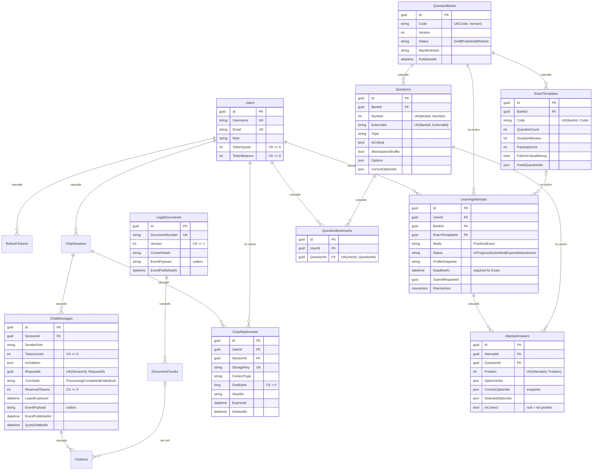

# Bảo — thiết kế dữ liệu, quota, progress/report (B01–B06)

Ngày: 25/10/2026. Nhánh `PRN-BAO-dev`, dựng trên `origin/PRN-VUONG-dev` (`c96ae9e`) vì nhánh đó đã thêm cột durable turn vào `ChatMessages`; migration của Bảo phải nối tiếp chuỗi migration đó để không tạo hai nhánh migration song song.

Tài liệu này là **decision log + ERD được chốt trước khi tạo migration** (tiêu chí B02). Migration chỉ được tạo sau khi các quyết định dưới đây được ghi lại.

## 1. ERD



## 2. Decision log

| # | Quyết định | Lý do / hệ quả |
| --- | --- | --- |
| D1 | 7 bảng core giữ nguyên tên/quan hệ. Trạng thái turn, outbox và quota marker nằm trên `ChatMessages` (turn = assistant message có `RequestId`), không thêm bảng outbox/quota/violation/usage. | Theo teacher scope 22/10. Event pending và quota cùng commit với kết quả chat trong một transaction. |
| D2 | `TurnState` là chuỗi `Processing`/`Completed`/`Failed` (hằng số `BusinessObject.Constants.ChatTurnStates`), `null` = message cũ. Có CHECK constraint. | Giữ tương thích code Vương đang dùng chuỗi; DB chặn giá trị lạ. |
| D3 | CHECK `TokenBalance >= 0`, `TokenQuota >= 0`, `TokensUsed/ReservedTokens >= 0`, `RequestId` luôn kèm `RequestHash`. | Bug quota không thể làm số dư âm hoặc turn không kiểm tra replay được. |
| D4 | `LegalDocuments` thêm `Version`, `ContentHash`, `EventPayload`, `EventPublishedAt`. Index lọc cho event chưa publish ở cả `ChatMessages` và `LegalDocuments`. | Version constraint cho citation/index; outbox `document-updated-events` cho Phúc/Khánh mà không thêm bảng. |
| D5 | Học/thi là **module mở rộng** gồm 6 bảng: `QuestionBanks`, `Questions`, `ExamTemplates`, `LearningAttempts`, `AttemptAnswers`, `QuestionBookmarks`. Tạo bằng migration riêng `LearningAndAttachments` để có thể revert độc lập nếu giảng viên không duyệt. | Plan cấm nhét bài thi vào `ChatMessages`. Không có bảng progress/report: tiến độ derive từ attempts/answers. |
| D6 | Một dòng `QuestionBanks` = một version bất biến (`UK(Code, Version)`). Bank đã `Published` không sửa câu; sửa = import version mới. `Questions.ExternalId` giữ ổn định giữa các version. | Lịch sử chấm không đổi khi bank đổi. Bookmark/progress tính theo bank version (đúng tiêu chí B04). |
| D7 | Snapshot bài làm: khi bắt đầu attempt tạo sẵn mọi `AttemptAnswers` với `Position`, `OptionOrder` (permutation theo option ID) và **bản sao** `CorrectOptionIds`. Profile/tiêu chí chọn câu copy vào `LearningAttempts.ProfileSnapshot/SelectionCriteria`. | Chấm theo snapshot, không đọc template/key "latest". Không lưu lại toàn bộ nội dung câu vì dòng `Questions` đã bất biến (D6). |
| D8 | `AttemptAnswers.IsCorrect = null` cho tới khi được chấm: chế độ học chấm ngay khi trả lời; bài thi chỉ set khi submit/hết giờ. | Progress chỉ đếm câu có `IsCorrect != null` ⇒ không lộ kết quả bài thi đang chạy và không đếm câu chưa chấm. |
| D9 | Submit idempotent: `LearningAttempts.RowVersion` (optimistic concurrency) + `SubmitRequestId`. Hai submit đồng thời: một cái thắng, cái kia nhận `DbUpdateConcurrencyException` rồi đọc lại kết quả đã chấm. `UK(AttemptId, QuestionId)` chặn nhân đôi câu. | Không nhân đôi lượt submit (tiêu chí B04). |
| D10 | Exam bắt buộc `DeadlineAt` (CHECK). Index lọc `Status = InProgress AND DeadlineAt IS NOT NULL` cho job hết giờ của Khánh. | Timer server là nguồn chuẩn. |
| D11 | `ChatAttachments` chỉ lưu metadata (owner, session, storage key, MIME, size, SHA-256, hạn giữ, soft delete). Byte ảnh ở private storage; không base64 trong SQL. | Đáp ứng V03. FK user là `NO ACTION` vì SQL Server không cho hai đường cascade (Users→Sessions→Attachments đã cascade). |
| D12 | Xóa bank/câu có lịch sử bị chặn (`NO ACTION` từ attempts/answers). Retire bằng `Status = Retired`. | Không mất lịch sử đã chấm. |
| D13 | Quota (B03) không giữ transaction trong lúc gọi AI: reserve và settle là hai transaction ngắn có khóa `UPDLOCK` trên dòng `Users`. Settle exactly-once nhờ chuyển trạng thái `QuotaSettledAt IS NULL → NOT NULL` trong cùng transaction trừ `TokenBalance`. Chi tiết mục 3. | Không lock DB xuyên lúc gọi AI; cùng event chỉ settle một lần. |
| D14 | Report usage (B05) đếm **turn** = assistant message `Completed` hoặc message assistant cũ (`TurnState` null). Token lấy từ assistant message. Không đếm user message. | Không đếm đôi user/assistant. |

## 3. Quota — máy trạng thái

Mỗi turn là một assistant message (ChatbotService của Vương tạo). Ngân sách khả dụng:

```
available = Users.TokenBalance − Σ ReservedTokens của các turn chưa settle và còn giữ chỗ
giữ chỗ   = (TurnState = Completed) hoặc (TurnState = Processing và LeaseExpiresAt > now)
```

| Bước | Ai gọi | Transaction | Kết quả |
| --- | --- | --- | --- |
| Reserve | REST (ChatbotService) | Khóa user → kiểm tra `available` → `ReservedTokens = min(available, yêu cầu)`, `TurnState = Processing`, `LeaseExpiresAt` | Hết quota ⇒ 429 |
| Gọi AI | REST | **Không transaction** | |
| Complete | REST (ChatbotService) | `TurnState = Completed`, `ReservedTokens = usage thực`, ghi `EventPayload` | Giữ chỗ đến khi settle |
| Release | REST khi AI lỗi | `TurnState = Failed`, `ReservedTokens = 0` (fenced bằng `LeaseId`) | Trả ngân sách |
| Settle | Worker (consumer `chat-completed-events`) | Khóa user → nếu `QuotaSettledAt IS NULL` và `Completed` thì trừ `TokensUsed` đã lưu trong SQL (không tin số trong payload) khỏi `TokenBalance` (sàn 0), `ReservedTokens = 0`, set `QuotaSettledAt` | Event lặp ⇒ `AlreadySettled`, không trừ lần 2 |
| Recovery | Job định kỳ | (a) `Processing` quá lease + grace ⇒ `Failed`, `ResultStatus = UsageUnknown`, nhả chỗ. (b) `Completed` chưa settle quá N phút ⇒ settle trực tiếp (idempotent với Worker). | Timeout/crash không kẹt ngân sách |

Usage không biết sau timeout: provider có thể đã tính phí nhưng hệ thống không có số liệu, nên recovery **nhả** reservation và đánh dấu `ResultStatus = UsageUnknown` để đối soát; không tự trừ số ước lượng của user. Muốn trừ theo reservation thì bật `Quota:ChargeReservationWhenUsageUnknown`.

## 4. Repository contracts cho các thành viên

| Interface (DataAccess) | Người dùng | Ghi chú |
| --- | --- | --- |
| `IQuestionBankRepository` | Phúc (import/publish/list), Khánh (chọn câu) | Thêm bank version + câu trong một `SaveChangesAsync`; query published/filter/range/topic. |
| `ILearningAttemptRepository` | Khánh (practice/exam engine) | Tạo attempt + answers snapshot; load theo owner; attempts hết hạn; submit dùng `RowVersion`. |
| `IQuestionBookmarkRepository` | Bảo (API), Phúc (UI học) | |
| `ILearningProgressRepository` | Bảo (progress/history), Khánh (chọn câu sai/chưa làm) | Chỉ trả dữ liệu thô; quy tắc "câu sai/chưa làm" ở `LearningProgressService`. |
| `IChatAttachmentRepository` | Vương (thay metadata file JSON) | Theo owner, chưa xóa, chưa hết hạn. |
| `IQuotaRepository` | Bảo (`QuotaService`) | Transaction có khóa user và execution strategy. |
| `IUsageReportRepository` | Bảo (report), Phúc (cron report) | Aggregation trên SQL. |
| `IUnitOfWork` | Khánh/Phúc khi cần transaction nhiều bước | Bọc execution strategy của `EnableRetryOnFailure`. |

DI: REST gọi `builder.Services.AddAccountLearningModule(builder.Configuration)` (`Presentation/Extensions`, đã thêm 1 dòng vào `Program.cs`); Worker gọi `services.AddQuotaAndLearningData(quotaSettings)` (`BusinessLogic/Extensions`) sau khi đăng ký DbContext, `IUserRepository` và `IGenericRepository<>`.

## 5. API (Bảo)

| Method | Route | Quyền | Ghi chú |
| --- | --- | --- | --- |
| GET | `/api/account/quota` | User | Số dư, phần giữ chỗ, phần khả dụng |
| GET | `/api/learning/progress` | User | Tóm tắt từng bank published + bank đã từng làm |
| GET | `/api/learning/progress/{bankId}` | User | Chi tiết + theo chủ đề; bank Draft ⇒ 404 |
| GET | `/api/learning/progress/{bankId}/wrong-questions` | User | Câu có lần chấm gần nhất sai, phân trang |
| GET | `/api/learning/progress/{bankId}/unseen-questions` | User | Câu chưa có lần chấm nào |
| GET | `/api/learning/history?bankId&mode&pageIndex&pageSize` | User | Lượt học/thi của chính mình |
| GET | `/api/learning/bookmarks?bankId` | User | |
| PUT / DELETE | `/api/learning/bookmarks/{questionId}` | User | Idempotent, 204 |
| GET | `/api/reports/usage?from&to&userId` | User / Admin | Ngày theo giờ Việt Nam, tối đa 366 ngày, mặc định 30 ngày. User truyền `userId` người khác ⇒ 403. Admin không truyền `userId` ⇒ toàn hệ thống + top 10 user |

Quy tắc đếm progress: một câu trả lời được tính khi `IsCorrect != null` **và** (attempt là Practice **hoặc** Exam đã `Submitted/Expired`). "Câu sai" = lần chấm gần nhất sai; "chưa làm" = chưa có lần chấm nào. Nếu Khánh muốn câu bỏ trống trong bài thi bị tính là sai thì khi chấm phải set `IsCorrect = false` cho câu đó.

## 6. Bàn giao cho thành viên khác

- **Vương:** `ChatbotService` hiện tự tính giữ chỗ trong `WithUserLockAsync`; quy tắc trùng với `IQuotaService.ReserveAsync/ReleaseAsync` nên có thể chuyển sang gọi service này khi tiện. `IChatAttachmentRepository` + bảng `ChatAttachments` sẵn để thay metadata file JSON. Đã thêm một dòng DI + `using Presentation.Extensions;` trong `Program.cs`, và trong `web/src/main.tsx` thêm route `/tien-do`, chuyển `Account` inline sang `features/account/AccountPage`.
- **Khánh:** consumer `chat-completed-events` gọi `IQuotaService.SettleAsync(evt.MessageId, evt.EventId)` — an toàn khi nhận trùng. Không cần chạy `QuotaRecoveryJob` ở Worker nếu REST đã bật (`Quota:RecoveryEnabled`). Engine học/thi dùng `ILearningAttemptRepository`, `IQuestionBankRepository`, `ILearningProgressService.GetWrongQuestionIdsAsync/GetUnseenQuestionIdsAsync`.
- **Phúc:** import bank version mới qua `IQuestionBankRepository.AddAsync` (bank + `Questions` + `ExamTemplates` cùng một `SaveChangesAsync`), lấy version tiếp theo bằng `GetLatestVersionAsync`. Outbox `document-updated-events` ghi vào `LegalDocuments.EventPayload` cùng transaction thay đổi văn bản, tăng `Version`. Cron report có thể gọi `IUsageReportService`.

## 7. Kiểm thử

`dotnet test tests/ChatAIWeb.Tests --filter "FullyQualifiedName~AccountLearning"` — 16 test chạy trên SQL Server thật (LocalDB mặc định, hoặc server trong `BAO_TEST_SQL`, mỗi lớp tạo DB riêng rồi xoá):

- Quota: settle lặp / 6 settle đồng thời chỉ trừ một lần; 5 reserve đồng thời không vượt số dư; release theo lease; lease hết hạn không giữ ngân sách và recovery nhả/charge theo cấu hình; recovery settle turn bị mất event và event đến muộn không trừ lần 2; overrun dừng ở 0. Đã thử bỏ `UPDLOCK` thì hai test đồng thời fail.
- Progress/report: chỉ đếm câu đã chấm, mỗi câu một lần, không lộ dữ liệu user khác, Draft ẩn, bookmark idempotent; report đếm turn chứ không đếm message, User/Admin đúng phạm vi.
- API qua `WebApplicationFactory` (host REST thật + migrations): login sai/đúng, profile, refresh rotation (token cũ 401), logout (token 401, logout lặp 204), ownership chat/report, progress/bookmark/history/quota/report qua HTTP.

Giới hạn: chưa có Worker/Kafka thật nên chưa kiểm settle từ event broker; chưa có bank thật nên UI chỉ được kiểm bằng dữ liệu fixture ghi rõ là test.
