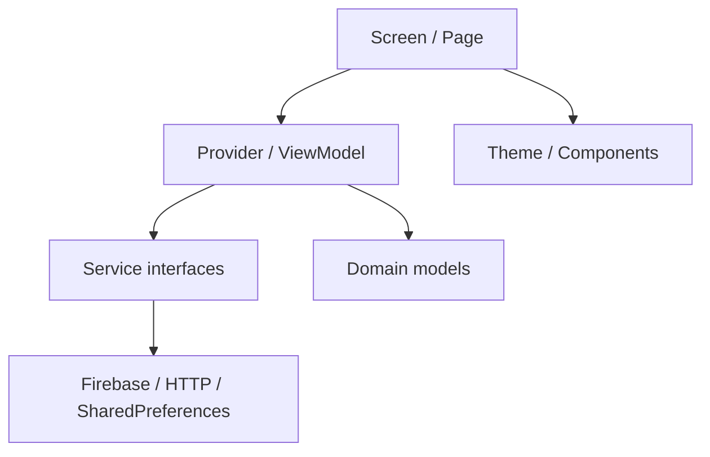
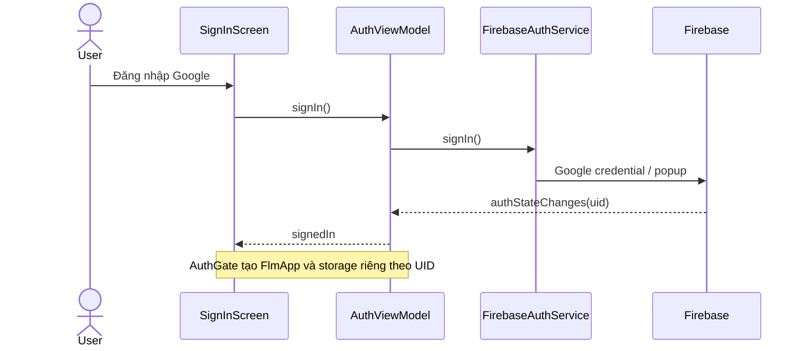

# Kiến trúc Flutter — trạng thái triển khai 21/10/2026

## Phạm vi
Ứng dụng hiện dùng Provider, các model và service Dart, dữ liệu FLM từ asset có nguồn và RAG FastAPI. Đang chuyển dần sang MVVM; chưa tuyên bố toàn app đạt MVVM hoặc Final không custom server. Firebase production đang được provisioning, chưa có kết quả đăng nhập thật.

## Thư mục và hướng phụ thuộc
| Thư mục | Vai trò |
|---|---|
| lib/app | Composition root, bootstrap Firebase và auth gate, shell điều hướng |
| lib/screens, lib/pages, lib/features/*/views | Render UI và chuyển tiếp thao tác |
| lib/state, lib/features/*/providers | ViewModel, trạng thái và orchestration |
| lib/services, lib/features/*/services | API, Google/Firebase authentication, tính toán học vụ |
| lib/data | Repository và adapter lưu trữ theo UID |
| lib/models | Dữ liệu nghiệp vụ |
| lib/theme, lib/widgets | Token và component dùng chung |

## Auth và ranh giới dữ liệu
Production `main` chạy `FirebaseEntry`, khởi tạo SDK rồi inject `AuthService` vào `AuthViewModel`. Chưa cấu hình hoặc lỗi khởi tạo: màn lỗi có Thử lại. Auth đang tải: spinner. Signed out: SignInScreen; signed in: FlmApp có key theo UID. Cây Provider, Navigator và state cũ bị tháo khi đổi UID/đăng xuất.

| ViewModel | Service / dependency | Trạng thái hiện tại |
|---|---|---|
| AuthViewModel | AuthService, PersonalPreferences | loading/signedOut/signedIn/error, busy, message |
| LearningProfileProvider | PersonalPreferences | isLoaded, hồ sơ tự khai |
| TranscriptProvider | PersonalPreferences, GradeCalculator | isLoaded, entries, GPA; cần nâng state lỗi tải |
| ChatProvider | ChatApiService, LearningProfileProvider, PersonalPreferences | loading, error, server health, history |
| TranscriptImportViewModel | TranscriptImagePicker, GradeImportService factory | idle/loading/empty/error/data; cancellation, retry, merge theo môn và kỳ |
| CourseCatalog | CourseRepository | dữ liệu chương trình/môn từ nguồn hiện tại |

`PersonalPreferences(uid)` giữ namespace cố định `account/{uid}/`. Tài khoản mới không tự nhận dữ liệu local cũ. Sign out khóa ghi namespace, đóng phiên Firebase, đợi thao tác ghi đang chạy rồi xóa cache của tài khoản đó. Nếu sign out thất bại, mở lại cache cho retry. Không xóa namespace của tài khoản khác hay dữ liệu local cũ.

## Design system
`lib/theme/app_theme.dart`: palette, radius và ThemeData hiện có. Cần tiếp tục gom spacing/elevation/text token và thay one-off widget; không coi tồn tại theme là đã đạt toàn bộ rubric. Nguồn component và trạng thái Figma nằm trong `design/figma-progress-2026-10-21.md`.

## Các gap còn mở
- Cloud Firestore, dữ liệu đa thiết bị và rules chưa được kiểm chứng.
- Đã chuyển picker/OCR/merge và sort bảng điểm ra khỏi TranscriptScreen; các screen còn lại cần audit tiếp.
- Final cần shared package `packages/core/`, client web và loại dependency FastAPI khỏi luồng nộp Final.
- Profile local-only cũ và cloud Final phải có đặc tả đồng bộ; không tự đưa ảnh bảng điểm vào kho RAG chung.
