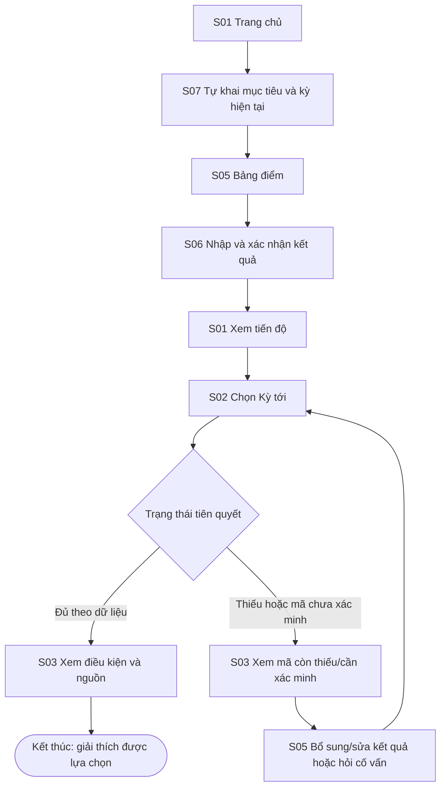
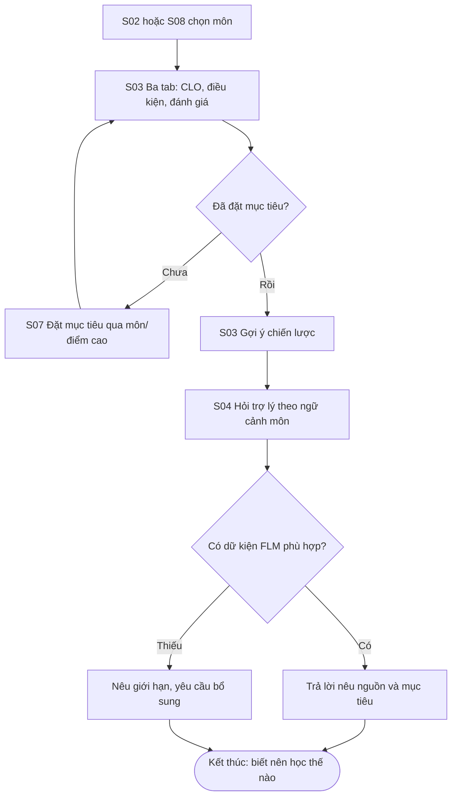
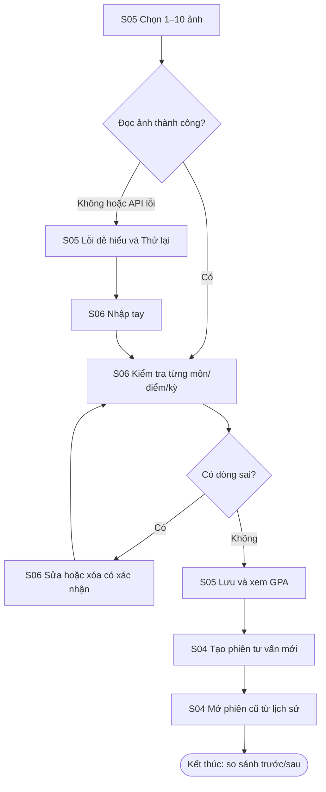

# Kiến trúc thông tin và user flow — FLM

Trạng thái: **luồng từ source Flutter hiện tại**. Đây là đặc tả để dựng Figma, chưa phải bằng chứng prototype Figma đã chạy.

## IA — tám đích điều hướng

| ID | Màn hình | Cấp | Đường vào hiện có |
| --- | --- | --- | --- |
| S01 | Trang chủ / tiến độ | Gốc | Khởi động app, tab Trang chủ |
| S02 | Lộ trình theo học kỳ / sơ đồ | Gốc | Tab Lộ trình, CTA từ S01 |
| S03 | Chi tiết môn | Con | Chọn môn từ S01/S02/S08 |
| S04 | Trợ lý và lịch sử phiên | Gốc | Tab Trợ lý, hoặc trợ lý ngữ cảnh từ S03 |
| S05 | Bảng điểm | Gốc | Tab Bảng điểm, CTA từ S01/S03 |
| S06 | Xác nhận / sửa bảng điểm | Con | Nhập ảnh hoặc nhập tay từ S05 |
| S07 | Cài đặt / hồ sơ tư vấn | Gốc | Tab Cài đặt, CTA từ S01 |
| S08 | Chương trình đào tạo | Con | “Chương trình đào tạo” từ S01 |

Dialog tư vấn, sheet chat, loading/empty/error là biến thể trạng thái, **không tính thêm màn hình**. Trên mobile dùng thanh điều hướng dưới; từ 900 dp, app dùng thanh điều hướng bên trái. Back ở S03/S06/S08 trở về màn đã mở; các tab gốc giữ vị trí riêng.

## F01 — Từ kết quả học đến môn kỳ tới

**Start:** S01, **goal:** biết một môn có thể cân nhắc kỳ tới và căn cứ tiên quyết, **end:** S03 đã xem điều kiện. Primary P01.

Nếu bảng điểm trống, ứng dụng yêu cầu nhập trước khi kết luận đủ tiên quyết. Nếu chưa xác nhận kỳ, chỉ hiện kỳ suy ra từ kết quả gần nhất/môn đang học và cho phép sửa ở S07.

## F02 — Chiến lược cho một môn theo mục tiêu

**Start:** S02 hoặc S08, **goal:** nhận gợi ý theo mục tiêu cá nhân và dữ liệu môn, **end:** S04 trả lời có nguồn/giới hạn. Primary P01.

## F03 — Nhập ảnh thất bại, phục hồi và hỏi lại

**Start:** S05, **goal:** có bảng điểm đúng rồi nhận tư vấn cập nhật, **end:** S04 có phiên mới và phiên cũ vẫn mở được. Primary P01.

Ảnh gửi backend để trích xuất; bảng điểm đã xác nhận lưu trên thiết bị. Flow thiết kế không khẳng định OCR luôn đúng.

## Flow → screen

| Flow | Màn hình | Nhánh thay thế / phục hồi |
| --- | --- | --- |
| F01 | S01, S07, S05, S06, S02, S03 | Thiếu tiên quyết hoặc chưa có kỳ/bảng điểm |
| F02 | S02, S08, S03, S07, S04 | Chưa có mục tiêu hoặc thiếu dữ liệu FLM |
| F03 | S05, S06, S04 | Ảnh/API lỗi → nhập tay; sửa/xóa trước lưu |

Tất cả S01–S08 thuộc ít nhất một flow. Nguồn quy cách flow: [Đề Lab 2](https://prm393-material.web.app/docs/PRM323-Lab2-Thiet-ke-UIUX-co-ho-tro-AI.pdf), [Chuẩn chung C6/C7](https://prm393-material.web.app/#standards).
